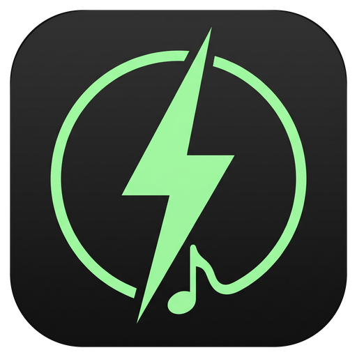
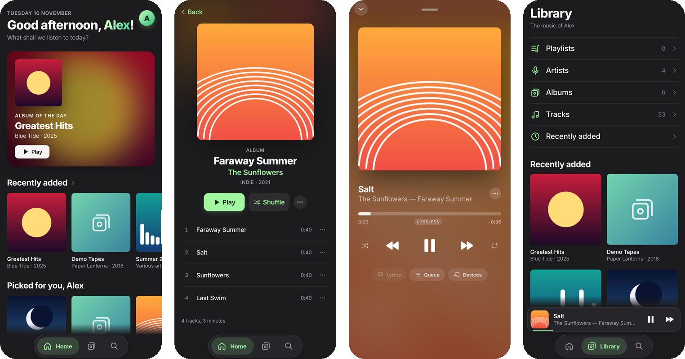
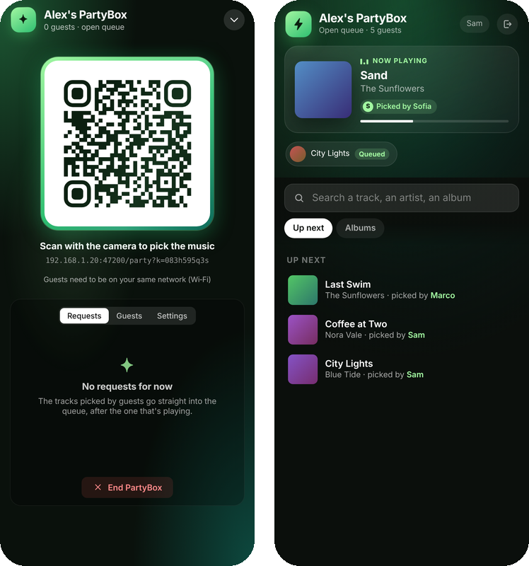
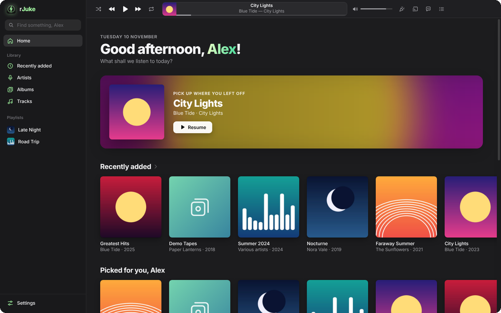
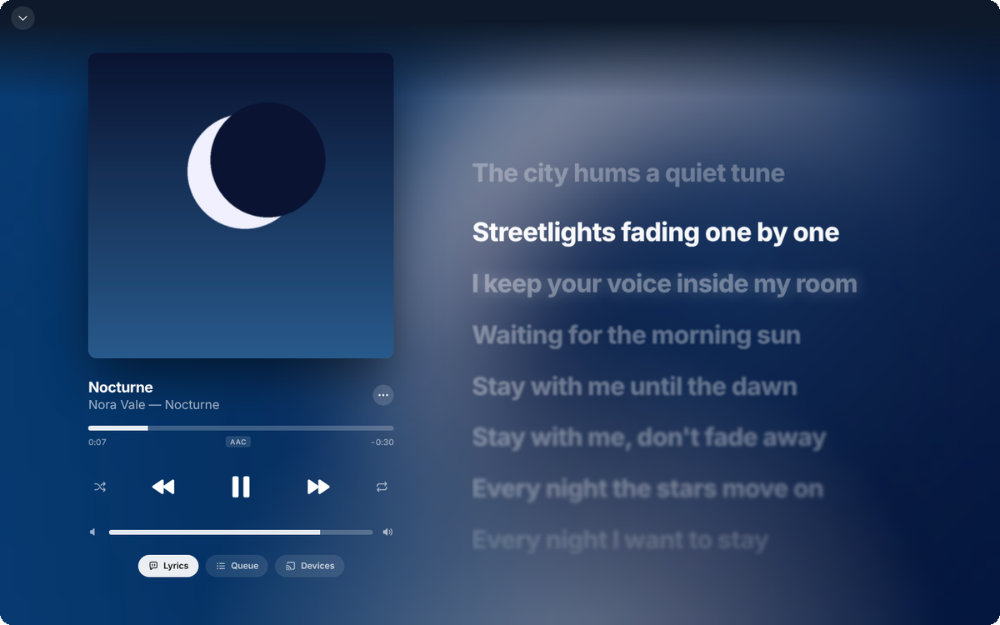
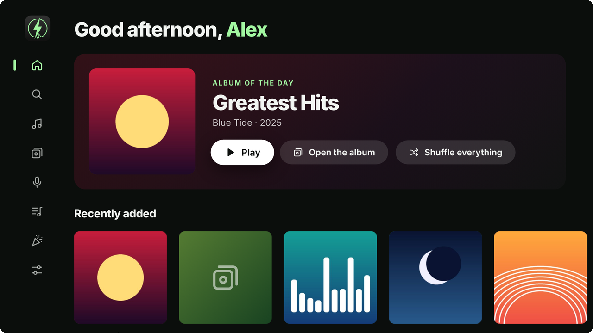
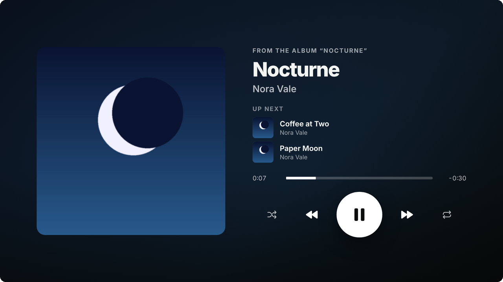

<div align="center">



# rJuke

**Your personal jukebox: all your music, offline, on your phone, your TV and your PC.**

Synced lyrics, smart playlists, a party mode your friends join with a QR code,<br>
and devices that talk to each other on your home Wi‑Fi. No accounts, no ads, no tracking.

[](https://github.com/ruoccoS/rJuke/releases/latest)


[](LICENSE)



</div>

---

## Why rJuke

Streaming apps rent you music. rJuke plays **the music you already own**, the files on your phone, your PC or a USB drive, and makes it feel like a premium music app: big covers, animated backgrounds, lyrics that follow the song.

Your devices work together. Control the PC from the sofa with your phone, move the music from one to the other, let the TV play the songs stored on your phone, or throw a party where every guest picks a track from their own phone without installing anything.

Everything stays on your home network. There's no account to create and nothing is sent to anyone.

## Features

### 🎧 A music app that looks the part
- **Home** with the album of the day, recently added and recently played, and picks for you that change every day
- **Now Playing** with an animated background taken from the cover's colours, a format badge (MP3, FLAC, Lossless…) and smooth gestures: swipe the mini player to change track, drag it down to close
- **Fast library** that stays smooth with thousands of tracks: artists (with “feat.” and multi-artist tracks split properly), albums, tracks, recently added
- **Instant search** across tracks, albums and artists
- Light and dark theme, following the system or your choice
- **English and Italian**, picked automatically from the system or set by hand in Settings

### 🎤 Synced lyrics
- Read from the file's tags (LRC in USLT / LYRICS, SYLT frames) or from an `.lrc` file next to the track
- Line-by-line **and word-by-word** (enhanced LRC) highlighting; tap a line to jump there

### 📃 Playlists that just work
- Create, reorder by dragging, add tracks from any menu
- **Import `.m3u8` / `.m3u` files**: tracks are matched to your library even when paths don't match, and the ones that can't be found are listed so you can **review them one by one** with suggestions, or skip them
- Playlists found in your music folder are **imported automatically** at every scan, never duplicated
- Export any playlist back to `.m3u8`

### 🎉 PartyBox
- Start a party and a **QR code** appears: friends scan it and **pick tracks from their phone's browser**, no app needed
- **Open queue** or **approval** mode, a limit on how many tracks each guest can queue, and guest management (remove whoever is spamming the queue)
- Guests see what's playing, what's next and the state of their requests, with a little confetti when their song comes on
- Works with the phone's hotspot too, so you can run it in the car, and it can be started straight from **Android Auto**

<div align="center"></div>

### 📡 rJuke Connect
- Phones, TVs and PCs running rJuke **find each other automatically** on the home Wi‑Fi (with a direct network scan as a fallback, and connection by address as a last resort)
- **Remote control**: play, pause, skip, seek, queue, the volume of a PC, and search the other device's library
- **Move the music**: “Listen here” brings what's playing on another device to this one, at the same position
- Pick the **name and icon** other devices see; a device can only control yours after you allow it the first time

### 💻 PC as a speaker
Keep your library on the phone and use the PC as a speaker (handy at the office): the PC gets the full track list with covers, lyrics and playlists, and fetches each track only when you play it. Played tracks stay in a cache you size (1 to 10 GB), and the phone keeps serving music **even with the screen locked**.

### 📺 Android TV
- A dedicated **10-foot interface** designed for the remote: arrows, OK and Back, with long-press menus
- Music from the **TV's storage or a USB drive**, or **from your phone or PC**: the TV keeps the tracks you play (up to 1 GB) so they start right away
- PartyBox on the big screen, with the QR code your guests scan from the sofa
- A light mode that turns itself on when the TV is struggling

### 🚗 Android Auto
- Browse playlists, artists and albums in the car, with a home page of recent and suggested music
- **“Ok Google, play … on rJuke”**: voice search for an artist, album or track
- Shuffle and repeat buttons, precise seeking (even in MP3s without an index)
- Steering-wheel controls: a short press changes track, holding it **seeks within the track**
- Start or stop PartyBox from the car and show its QR code on the car screen

### 🔒 Private by design
- No account, no ads, no analytics
- Connect and PartyBox only answer devices on your **home network**
- Your music files are never modified

## Screenshots

<table>
  <tr>
    <td></td>
    <td></td>
  </tr>
  <tr>
    <td></td>
    <td></td>
  </tr>
</table>

## Download

Every [release](https://github.com/ruoccoS/rJuke/releases/latest) contains both apps, built from the same code:

| Platform | File | How to install |
| --- | --- | --- |
| **Android** (phone, tablet, Android TV, Android Auto) | `rJuke-x.y.z-Android.apk` | Open the APK on your device and allow installing apps from your browser or file manager. On a TV, use a file manager or `adb install`. |
| **Windows 10 / 11** (x64) | `rJuke-x.y.z-Windows.zip` | Extract the whole folder and run `rJuke.exe`. Windows may show “Windows protected your PC” the first time: click *More info → Run anyway* (the app isn't code-signed). |

The Windows zip includes a `README.txt` with tips on PartyBox, Connect and keyboard shortcuts.

### Supported formats
MP3, FLAC, M4A (AAC), OGG, Opus and WAV. On Windows, ALAC (Apple Lossless) and WMA files can't be played.

## Building from source

The repository has two apps that share the same interface code:

```
app-android/   Capacitor app for phones, Android TV and Android Auto (web UI + native Java)
app-windows/   Electron app for Windows
design/        sources for generated files (the PartyBox guest page)
tools/         small build helpers
```

**Requirements:** Node.js 22, and for Android a JDK 21 and the Android SDK.

**Windows**

```bash
cd app-windows
npm ci
npm start              # run it
bash tools/package.sh  # build dist/rJuke-x.y.z-Windows.zip
```

**Android**

```bash
cd app-android
npm ci
npm run sync           # build the web UI and copy it into the Android project
cd android
./gradlew assembleDebug
```

Release builds are signed with the key passed through the `RJ_KEYSTORE`, `RJ_KEY_ALIAS`, `RJ_KEYSTORE_PASSWORD` and `RJ_KEY_PASSWORD` environment variables. The [release workflow](.github/workflows/release.yml) builds both apps on every push and publishes a release when the version in `package.json` is new.

### Translations

The interface is written in English and translated with a simple dictionary: `lang-it.js` maps every English text to Italian. To add a language, copy it to `lang-xx.js`, translate the values, load it in the two `index.html` files and in `app-windows/main.js`, and add it to `LANGS` in `i18n.js`. Pull requests are welcome!

## Human × AI

rJuke is an **AI-assisted project**, built as a collaboration between a person and an AI.

- **Design and direction** — [ruoccoS](https://github.com/ruoccoS): the idea, every feature, how it looks and how it behaves.
- **Code** — written together with Claude, Anthropic's AI model, working side by side on each change.
- **Review and testing** — every change was reviewed by [ruoccoS](https://github.com/ruoccoS) and tested on real phones, TVs, cars and PCs before release.

If something looks off, please [open an issue](https://github.com/ruoccoS/rJuke/issues).

## License

rJuke is free software, released under the [GNU General Public License v3.0](LICENSE) or later.
